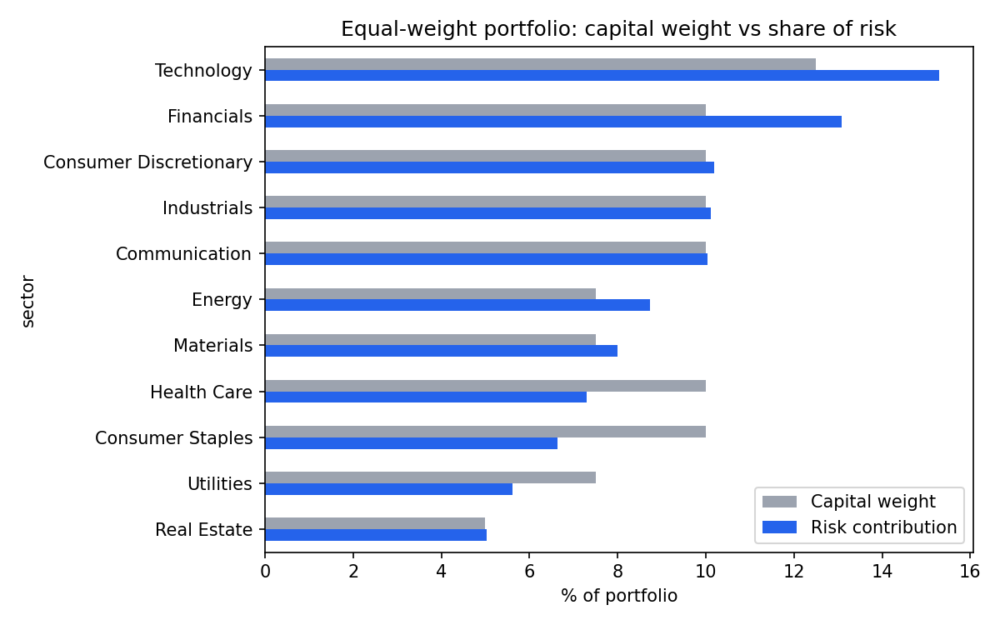
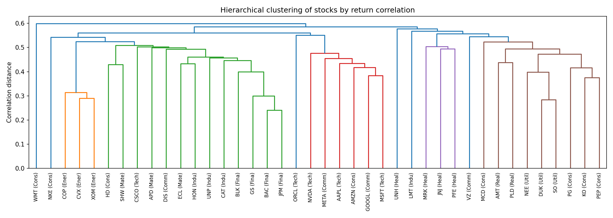
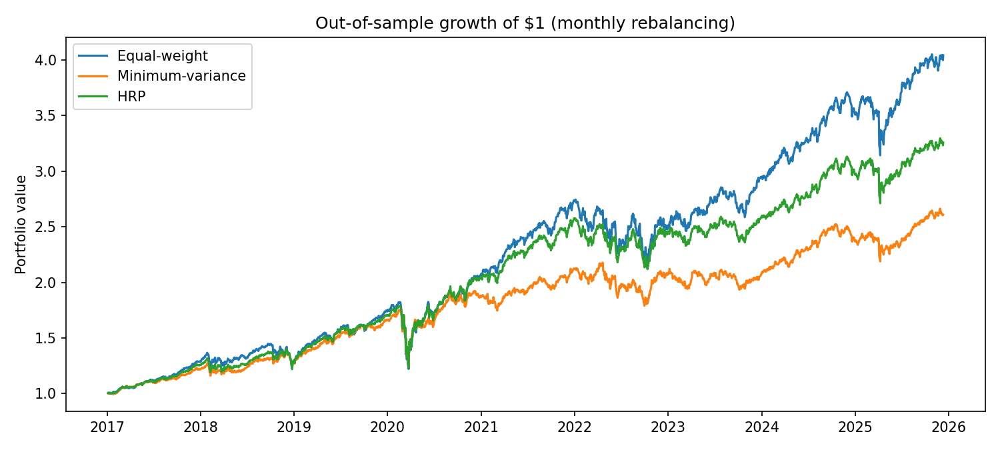

# Portfolio Risk Attribution & Hidden Concentration Detector

**A 40-stock portfolio spread evenly across all 11 sectors looks diversified. Is it really?**

Using 10 years of daily returns for 40 S&P 500 stocks (2,512 trading days, 2016–2025), this project measures where a portfolio's risk actually comes from. It uncovers hidden concentration that sector labels miss, then tests risk-based portfolio construction out-of-sample.

## Key findings

| Finding | Result |
|---|---|
| Effective number of bets (equal-weight, 40 holdings) | **1.1** |
| Share of risk from the single largest factor (the market) | **98%** |
| Largest correlation cluster | **13 stocks: 32% of capital → 37% of risk** |
| Clusters that cut across sector labels | **3 of 11** (adjusted Rand index vs sectors = 0.23) |
| Realised / forecast vol, min-variance (Sample vs Ledoit-Wolf) | **0.86 vs 0.87** |
| Sharpe: HRP vs Min-variance vs Equal-weight | **0.93 vs 0.82 vs 1.00** |
| Max drawdown: HRP vs Equal-weight | **−31.0% vs −33.0%** |
| Monthly turnover: HRP vs Min-variance | **11.0% vs 12.8%** |

**What this means:**
- **Diversification is mostly an illusion here.** Holding 40 stocks across 11 sectors gives about one independent bet, because almost all the risk is a single market factor. Correlation clusters also don't line up with sector labels (ARI 0.23), so sector-based diversification rules miss real concentration.
- **Shrinkage made little difference.** Ledoit-Wolf and the sample covariance gave almost identical forecasts. Both *over*-estimated next-month risk by about 13–14%, which is a useful negative result for this universe size and window length.
- **HRP vs the benchmarks.** HRP beat minimum-variance on risk-adjusted return (Sharpe 0.93 vs 0.82) with 14% less turnover, and had a shallower drawdown than equal-weight. However, simple equal-weight had the best Sharpe (1.00) in this mostly rising 2017–2025 market. That's consistent with the well-known finding that 1/N is hard to beat out-of-sample (DeMiguel et al., 2009).

## Methods

1. **Risk attribution:** portfolio volatility σ = √(wᵀΣw) is decomposed into marginal (Σw/σ) and component (w·Σw/σ) risk contributions per stock and per sector.
2. **Effective Number of Bets** (Meucci, 2009): the entropy of risk contributions across principal components of Σ.
3. **Hierarchical clustering** on the correlation distance √(½(1 − ρ)) with average linkage, compared with sector labels using the adjusted Rand index.
4. **Covariance forecasting test:** each month, Σ is estimated from the previous 252 days (sample vs Ledoit-Wolf), a long-only minimum-variance portfolio is built, and forecast volatility is compared with realised volatility over the next 21 days.
5. **Backtest:** equal-weight vs long-only minimum-variance vs **Hierarchical Risk Parity** (López de Prado, 2016). Monthly rebalancing on a 252-day lookback with Ledoit-Wolf covariance and no look-ahead.

**Limitations:** Sharpe ratios assume a 0% risk-free rate. Transaction costs are excluded, so turnover is reported instead. The universe uses current large-cap stocks, so survivorship bias applies. Weights are held constant between rebalances.

## How to run

Open `portfolio_risk_concentration_r.ipynb` in [Google Colab](https://colab.research.google.com) and click **Runtime → Run all** (about 3–5 minutes, no GPU needed). Data comes free from Yahoo Finance via `yfinance`.

## Tech stack

Python · Pandas · NumPy · SciPy · scikit-learn · yfinance · Matplotlib

## References

- Meucci, A. (2009). *Managing Diversification.* Risk.
- Ledoit, O. & Wolf, M. (2004). *Honey, I Shrunk the Sample Covariance Matrix.* Journal of Portfolio Management.
- López de Prado, M. (2016). *Building Diversified Portfolios that Outperform Out of Sample.* Journal of Portfolio Management.
- DeMiguel, V., Garlappi, L. & Uppal, R. (2009). *Optimal Versus Naive Diversification.* Review of Financial Studies.
